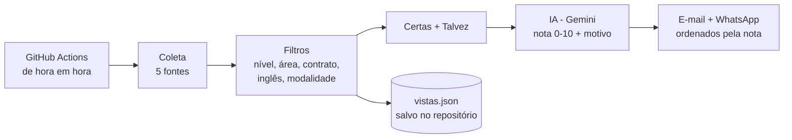

# 🤖 Robo-vagas: caçador de vagas júnior com IA

Um robô que roda sozinho no GitHub Actions, de hora em hora. Ele busca vagas júnior de tecnologia em 5 fontes do Brasil, descarta o que não serve e **usa um LLM (Google Gemini) para dar uma nota de 1 a 10** de compatibilidade entre cada vaga e o meu perfil. As vagas chegam por e-mail e WhatsApp, da melhor para a pior.

Criei para resolver um problema meu: eu passava horas por dia abrindo vagas que não tinham nada a ver comigo. Agora eu abro só as que têm nota alta.

## Como funciona



1. **Coleta** em 5 fontes: Gupy, Sólides, Remotar, Programathor e as comunidades de vagas no GitHub (frontendbr, backend-br, react-brasil, qa-brasil).
2. **Filtros com regras** (regex sobre o título e a descrição):
   - só júnior, trainee ou recém-formado, sem pleno/sênior
   - só as áreas que eu quero (desenvolvimento, QA, UX e dados); tira infra, cloud, segurança, suporte, iOS e áreas fora de TI
   - tira PJ, vagas exclusivas para PcD, vagas em espanhol e vagas com mais de 7 dias
   - tira quem exige inglês intermediário ou avançado, mas mantém quando o inglês é só diferencial
   - remotas sempre; híbridas e presenciais só no Ceará, a partir de uma data
3. **"Talvez"**: vagas que passam nos filtros, mas têm um ponto de dúvida (pede para morar em outra cidade, horário noturno, vaga em inglês, "qualidade" que pode não ser de software). Vão numa seção separada, com o motivo.
4. **Limpeza**: remove repetidas (mesma empresa e mesmo título em sites diferentes) e confere se a vaga ainda está aberta, inclusive em Greenhouse, Lever e Ashby.
5. **Avaliação com IA** (`ia.py` + `prompt.md`): o prompt traz meu perfil, 8 regras eliminatórias (CLT, remoto, júnior, inglês, turno etc.) e uma pontuação por área, tecnologias, básicos e bônus. O modelo devolve um JSON com formato fixo (*structured output*):
   ```json
   { "nota": 8, "eliminada": false, "motivos_eliminacao": [], "pontos_fortes": ["React e TypeScript"],
     "pontos_fracos": ["Pede Docker"], "alertas": ["Não diz o tipo de contrato"], "resumo": "..." }
   ```
6. **Envio**: um e-mail com as vagas "certas" e as "talvez", cada grupo ordenado pela nota, e um resumo no WhatsApp.
7. **Memória**: os IDs já vistos ficam em `vistas.json`, commitado pelo próprio robô, com tratamento de conflito quando duas rodadas rodam juntas.

## Decisões técnicas
- **Regras primeiro, IA depois**: os filtros baratos descartam centenas de vagas; a IA só avalia as poucas que sobram.
- **Rubrica explícita**: a nota segue critérios escritos no `prompt.md`, e o código garante a regra "eliminada vale no máximo 3" mesmo se o modelo errar.
- **Structured output** com `responseSchema`: a IA sempre devolve JSON válido.
- **Proteção contra prompt injection**: a descrição da vaga vai delimitada e o modelo é instruído a tratá-la só como dado.
- **Funciona sem IA**: se a chave faltar ou a API falhar, as vagas chegam do mesmo jeito, só que sem nota.
- **Resistente a mudanças**: usa apelidos de modelo (`-latest`) que não quebram quando o Google aposenta um modelo, e tenta mais de um endereço na Gupy.
- **Respeita a cota grátis**: no máximo 25 vagas avaliadas por rodada, pausa entre chamadas, nova tentativa em erro 429/503 e desiste depois de 2 falhas seguidas.
- **Log explicado**: cada rodada mostra quantas vagas foram descartadas e por qual motivo.

## Tecnologias
Python 3.12 · Requests · Regex · Google Gemini API · GitHub Actions (cron) · SMTP/Gmail · CallMeBot (WhatsApp)

## Como usar no seu GitHub
1. Faça um fork e edite o `prompt.md` com o seu perfil e as suas regras.
2. Gere uma chave grátis no [Google AI Studio](https://aistudio.google.com/apikey).
3. Em **Settings → Secrets and variables → Actions**, crie:
   - `GEMINI_API_KEY`: chave do Gemini
   - `GMAIL_USER` e `GMAIL_APP_PASSWORD`: Gmail e [senha de app](https://myaccount.google.com/apppasswords)
   - `EMAIL_DESTINO` (opcional): para onde mandar; o padrão é o próprio Gmail
   - `WHATSAPP_NUMERO` e `CALLMEBOT_APIKEY` (opcionais): para receber no WhatsApp via [CallMeBot](https://www.callmebot.com/blog/free-api-whatsapp-messages/)
4. Em **Actions**, rode o workflow uma vez no botão "Run workflow".

Variáveis opcionais: `GEMINI_MODEL` (padrão: `gemini-flash-lite-latest`, com `gemini-flash-latest` de reserva) e `IA_MAX_VAGAS` (padrão 25 por rodada).

---
Feito por [Alana Sena](https://www.linkedin.com/in/alanaasena)
